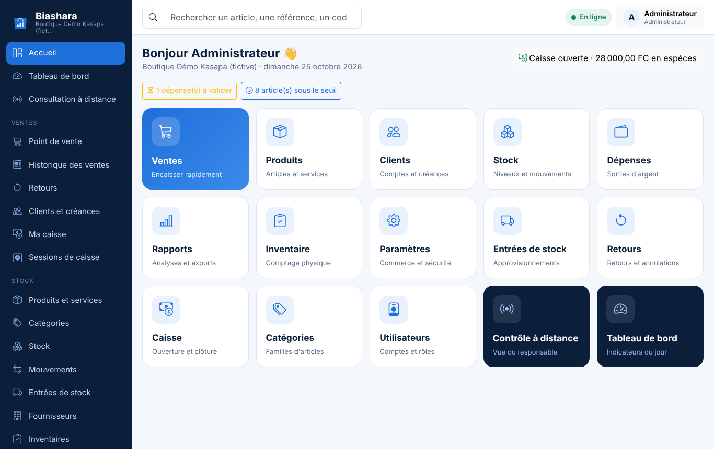
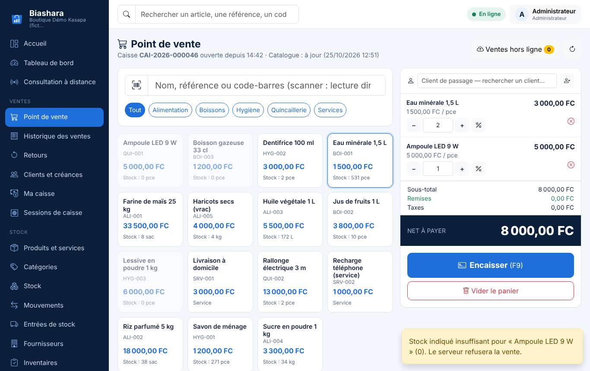
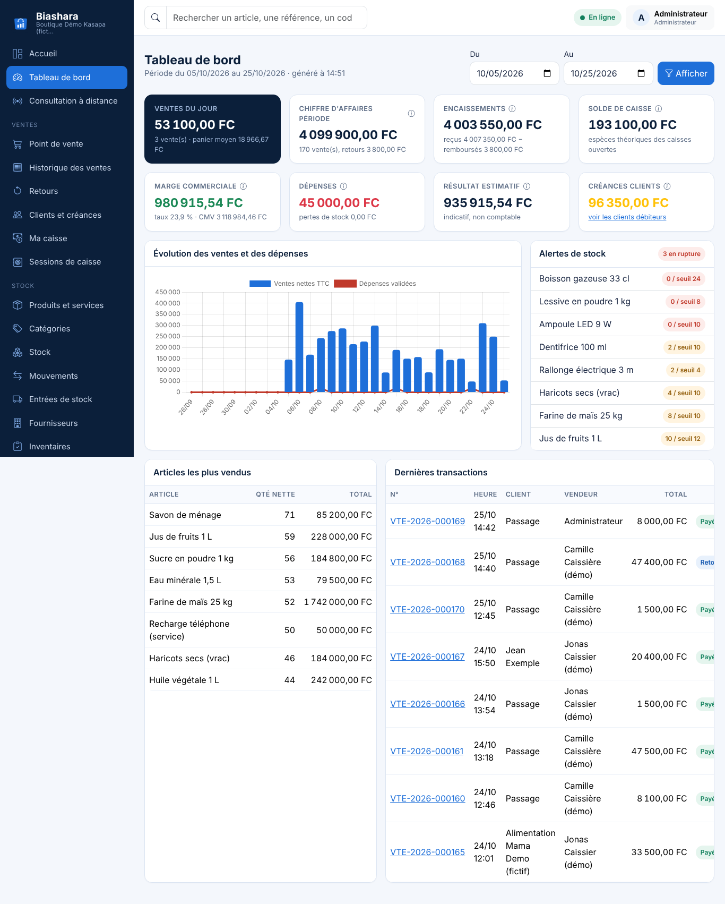
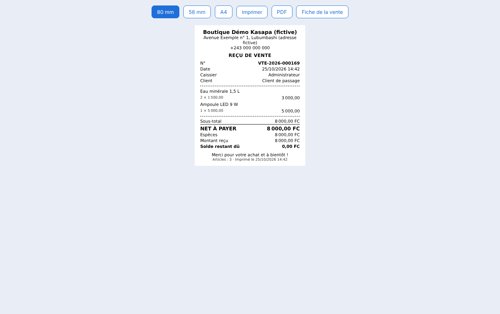
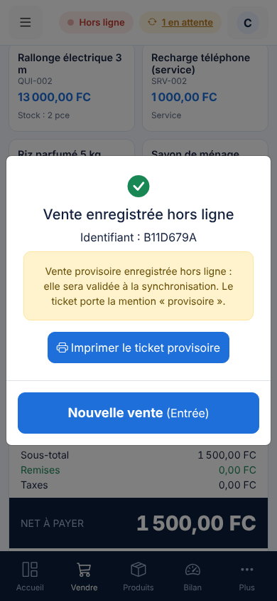

# Biashara — Gestion des ventes, des stocks et de la caisse

Application web complète de gestion commerciale pour PME : **point de vente** rapide (scanner, tactile, paiements multiples, crédit), **stock** tracé mouvement par mouvement, **caisse** avec clôture et écarts, **clients et créances**, **fournisseurs et approvisionnements**, **retours**, **dépenses**, **inventaires**, **rapports** (Excel/PDF), **consultation à distance** et **mode hors ligne** (PWA).

Interface entièrement en français, utilisable sur ordinateur, tablette, smartphone et terminal Android.
Laravel 12 · MySQL · Blade · Bootstrap 5 · JavaScript · Service Worker · IndexedDB.

| Accueil | Point de vente |
|---|---|
|  |  |

| Tableau de bord | Ticket 80 mm | Mobile hors ligne |
|---|---|---|
|  |  |  |

## Démarrage rapide (Windows / XAMPP)

Copiez ce dossier `biashara/` dans `C:\xampp\htdocs\biashara`, puis :

```powershell
cd C:\xampp\htdocs\biashara
composer install --no-dev --optimize-autoloader
copy .env.example .env
php artisan key:generate
# créer la base « biashara » (utf8mb4) dans phpMyAdmin, renseigner .env
php artisan migrate --seed --force
php artisan storage:link
php artisan db:seed --class=DemoSeeder   # facultatif : données FICTIVES de démonstration
php artisan serve --host=0.0.0.0 --port=8000
```

Connexion : `admin` / valeur de `INITIAL_ADMIN_PASSWORD` (par défaut `admin12345` — à changer immédiatement).
Avec les données de démonstration : `gerant`, `caissier`, `caissier2`, `magasinier` / `demo1234`.

Procédure détaillée (extensions PHP, Apache, HTTPS, sauvegarde/restauration, mise à jour) : **[docs/INSTALLATION.md](docs/INSTALLATION.md)**.

## Documentation

| Document | Contenu |
|---|---|
| [01 — Périmètre et règles de gestion](docs/01-PERIMETRE-ET-REGLES.md) | hypothèses, acteurs, règles métier, définition des indicateurs, politique hors ligne |
| [02 — Modélisation](docs/02-MODELISATION.md) | cas d'utilisation, diagramme de classes, séquence d'une vente, schéma relationnel |
| [03 — Architecture](docs/03-ARCHITECTURE.md) | couches, arborescence, sécurité, concurrence, PWA |
| [Installation](docs/INSTALLATION.md) | Windows/XAMPP, lancement, HTTPS, sauvegardes |
| [Guide utilisateur](docs/GUIDE-UTILISATEUR.md) | caissier, magasinier, gérant, administrateur |
| [Matériel](docs/MATERIEL.md) | scanners, imprimantes thermiques, Android/Bluetooth : possibilités et limites |
| [Dépendances](docs/DEPENDANCES.md) | versions exactes |

## Points clés

- **Aucun calcul monétaire en virgule flottante** : colonnes `DECIMAL`, calculs avec `brick/math` côté serveur et entiers `BigInt` côté navigateur.
- **Idempotence** : chaque vente, retour et règlement porte un identifiant généré par l'appareil ; double clic, re-tentative et synchronisation ne créent jamais de doublon.
- **Concurrence** : verrous de ligne (`SELECT … FOR UPDATE`) sur les articles ; deux caissiers ne peuvent pas vendre le même dernier article.
- **Stock = journal** : chaque variation est un mouvement (motif, auteur, document) ; `php artisan app:check-stock` vérifie la cohérence.
- **Marges historiques exactes** : coût moyen pondéré mobile, coût de sortie figé dans chaque ligne de vente.
- **Reçus immuables** : désignations, prix, remises et taxes figés à la vente ; mention « DUPLICATA » en réimpression.
- **Rien n'est supprimé** : annulations par opérations correctrices, archivage des articles et utilisateurs, journal d'audit.
- **Hors ligne honnête** : ventes provisoires synchronisées une seule fois, conflits soumis à un responsable, jamais modifiés silencieusement.

## Tests

```bash
php artisan test
```

45 tests (255 assertions) couvrent les critères d'acceptation :

| Critère | Test |
|---|---|
| Une vente diminue le stock | `SaleTest::test_une_vente_diminue_le_stock_et_cree_un_mouvement` |
| Un approvisionnement augmente le stock (et le CMP) | `StockAndPurchaseTest::test_un_approvisionnement_augmente_le_stock_et_met_a_jour_le_cmp` |
| Un service se vend sans mouvement de stock | `SaleTest::test_un_service_se_vend_sans_mouvement_de_stock` |
| Un double clic ne crée pas deux ventes | `SaleTest::test_double_clic_ne_cree_pas_deux_ventes` |
| Pas de vente simultanée du dernier article | `SaleTest::test_deux_caissiers_ne_peuvent_pas_vendre_le_meme_dernier_article` |
| Retour partiel borné par les quantités vendues | `ReturnsAndCreditTest::test_retour_partiel_respecte_les_quantites_vendues` |
| Article détérioré hors stock vendable | `ReturnsAndCreditTest::test_article_deteriore_ne_rejoint_pas_le_stock_vendable` |
| Règlement partiel : créance exacte, pas de double comptage | `ReturnsAndCreditTest::test_reglement_partiel_laisse_une_creance_exacte_et_nest_pas_compte_deux_fois` |
| Clôture de caisse et écarts | `CashAndExpenseTest::test_cloture_de_caisse_calcule_l_ecart` |
| Inventaire validé → ajustement traçable | `StockAndPurchaseTest::test_inventaire_valide_genere_un_ajustement_tracable_meme_avec_ventes_apres_releve` |
| Permissions non contournables | `PermissionTest` (6 tests) |
| Vente hors ligne synchronisée une seule fois | `OfflineSyncTest::test_une_vente_hors_ligne_n_est_synchronisee_qu_une_seule_fois` |
| Rapports conformes aux transactions | `ReportAndReceiptTest::test_les_indicateurs_correspondent_aux_transactions` |
| Anciens reçus inchangés après changement de prix | `SaleTest::test_les_anciens_recus_restent_inchanges_apres_modification_du_prix` |
| Reçus A4, 58 mm, 80 mm, PDF, duplicata | `ReportAndReceiptTest::test_recu_lisible_dans_les_trois_formats_avec_duplicata` |
| Tous les écrans s'affichent pour chaque rôle | `PagesTest` |

## Licence

Code applicatif : propriété de son auteur. Bibliothèques tierces : licences MIT (voir `public/vendor/*/LICENSE*` et `composer.lock`).
