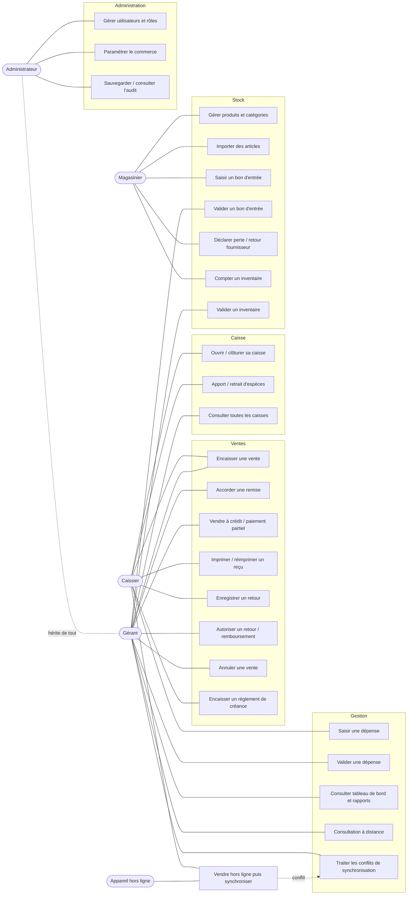
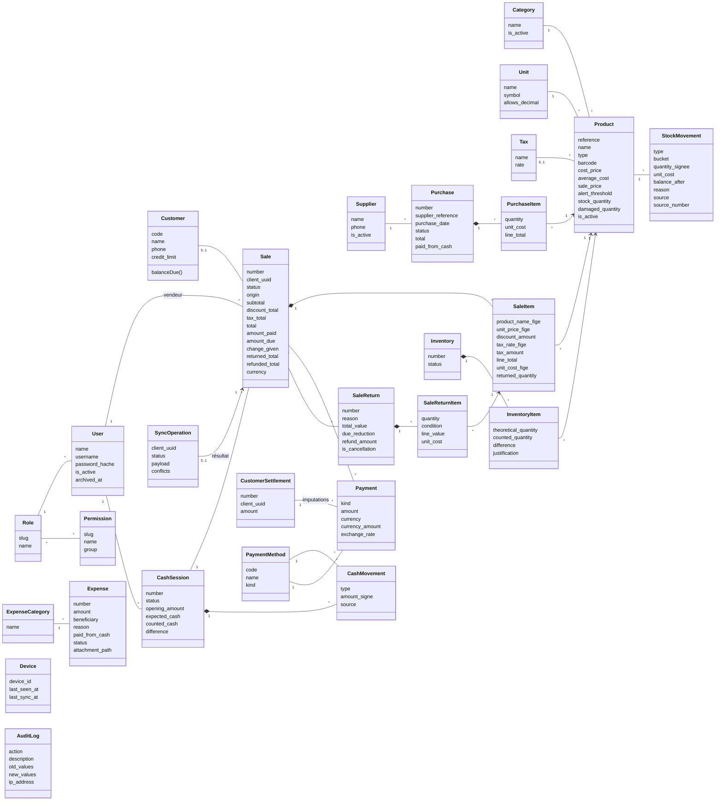
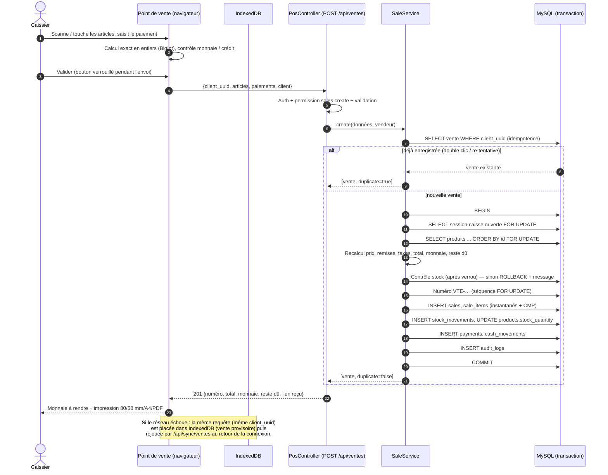

# 2. Modélisation

Les diagrammes sont écrits en [Mermaid](https://mermaid.js.org/) : ils s'affichent directement sur GitHub.

## 2.1 Cas d'utilisation

## 2.2 Diagramme de classes (domaine)

Les attributs suffixés `_fige` sont des valeurs figées au moment de la vente (instantané). `kind` : sale | debt_settlement | refund ; `bucket` : available | damaged ; `condition` : resaleable | damaged.

Les **services** portent la logique métier (un service = un processus transactionnel) : `SaleService`, `ReturnService`, `SettlementService`, `StockService`, `CashService`, `PurchaseService`, `ExpenseService`, `InventoryService`, `SyncService`, `ProductService`, `NumberingService`, `FinancialMetrics`, `ReportService`, `BackupService`, `AuditService`.

## 2.3 Diagramme de séquence — validation d'une vente

## 2.4 Schéma relationnel

Conventions : `id` BIGINT UNSIGNED AUTO_INCREMENT clé primaire ; `created_at`/`updated_at` ; moteur InnoDB, `utf8mb4`. Montants `DECIMAL(15,2)`, quantités `DECIMAL(15,3)`, coûts moyens `DECIMAL(15,4)`, taux `DECIMAL(7,4)`/`DECIMAL(15,4)`. **Aucun type flottant.**

| Table | Colonnes principales | Clés étrangères | Contraintes / index |
|---|---|---|---|
| `roles` | slug, name, description, is_system | — | UNIQUE(slug) |
| `permissions` | slug, name, group | — | UNIQUE(slug), INDEX(group) |
| `permission_role` | role_id, permission_id | → roles CASCADE, → permissions CASCADE | PK(role_id, permission_id) |
| `users` | name, username, email, phone, password, role_id, is_active, last_login_at, archived_at | → roles RESTRICT | UNIQUE(username), UNIQUE(email) |
| `settings` | key, value | — | UNIQUE(key) |
| `document_sequences` | type, label, prefix, next_number, padding, yearly_reset, current_year | — | UNIQUE(type) — verrouillée à chaque attribution |
| `payment_methods` | code, name, kind(cash/electronic), is_active, sort_order | — | UNIQUE(code) |
| `taxes` | name, rate, is_active | — | — |
| `categories` | name, description, color, is_active | — | UNIQUE(name), INDEX(is_active) |
| `units` | name, symbol, allows_decimal | — | UNIQUE(name) |
| `products` | reference, name, type, category_id, unit_id, tax_id, description, barcode, photo_path, cost_price, average_cost, sale_price, alert_threshold, stock_quantity, damaged_quantity, is_active | → categories RESTRICT, → units RESTRICT, → taxes SET NULL | UNIQUE(reference), UNIQUE(barcode), INDEX(name), INDEX(category_id, is_active) |
| `suppliers` | name, contact_person, phone, email, address, is_active | — | INDEX(name) |
| `customers` | code, name, phone, email, address, credit_limit, is_active | — | UNIQUE(code), INDEX(name), INDEX(phone) |
| `cash_sessions` | number, user_id, status, opening_amount, opened_at, expected_cash, counted_cash, difference, electronic_total, closing_notes, closed_at, closed_by, open_lock | → users RESTRICT | UNIQUE(number), **UNIQUE(open_lock)** = une session ouverte par caissier, INDEX(user_id, status) |
| `cash_movements` | cash_session_id, payment_method_id, type, amount±, description, source_type/id, user_id | → cash_sessions, payment_methods, users RESTRICT | INDEX(type), INDEX(source) |
| `sales` | number, client_uuid, customer_id, user_id, cash_session_id, status, origin, device_id, subtotal, discount_total, tax_total, total, amount_paid, amount_due, amount_received, change_given, returned_total, refunded_total, currency, exchange_rate, print_count, sold_at, cancelled_* | → customers, users, cash_sessions RESTRICT | UNIQUE(number), **UNIQUE(client_uuid)**, INDEX(status), INDEX(sold_at), INDEX(user_id, sold_at), INDEX(customer_id, amount_due) |
| `sale_items` | sale_id, product_id, product_reference*, product_name*, product_type*, unit_symbol*, quantity, unit_price*, discount_amount, tax_name*, tax_rate*, tax_amount, line_total, unit_cost*, returned_quantity | → sales CASCADE, → products RESTRICT | — |
| `customer_settlements` | number, client_uuid, customer_id, payment_method_id, cash_session_id, user_id, amount, reference, paid_at | → customers, payment_methods, cash_sessions, users | UNIQUE(number), **UNIQUE(client_uuid)** |
| `sale_returns` | number, client_uuid, sale_id, user_id, authorized_by, cash_session_id, refund_method_id, reason, total_value, due_reduction, refund_amount, is_cancellation, returned_at | → sales, users ×2, cash_sessions, payment_methods | UNIQUE(number), UNIQUE(client_uuid) |
| `sale_return_items` | sale_return_id, sale_item_id, product_id, quantity, condition, unit_value, line_value, unit_cost | → sale_returns CASCADE, → sale_items, products | — |
| `payments` | kind, sale_id, customer_settlement_id, sale_return_id, customer_id, payment_method_id, cash_session_id, user_id, amount±, currency, currency_amount, exchange_rate, reference, paid_at | → sales, customer_settlements, sale_returns, customers, payment_methods, cash_sessions, users | INDEX(paid_at), INDEX(kind, paid_at) |
| `purchases` | number, supplier_id, supplier_reference, purchase_date, status, total, paid_from_cash, notes, user_id, validated_by, validated_at | → suppliers, users | UNIQUE(number), INDEX(status) |
| `purchase_items` | purchase_id, product_id, quantity, unit_cost, line_total | → purchases CASCADE, → products | — |
| `stock_movements` | product_id, type, bucket, quantity±, unit_cost, balance_after, reason, source_type/id, source_number, user_id, occurred_at | → products, users RESTRICT | INDEX(type), INDEX(occurred_at), INDEX(product_id, occurred_at), INDEX(source) |
| `inventories` | number, category_id, status, notes, opened_by, validated_by, opened_at, validated_at | → categories, users | UNIQUE(number), INDEX(status) |
| `inventory_items` | inventory_id, product_id, theoretical_quantity, counted_quantity, difference, unit_cost, justification, counted_by, counted_at, last_movement_id | → inventories CASCADE, → products | UNIQUE(inventory_id, product_id) |
| `expense_categories` | name, is_active | — | UNIQUE(name) |
| `expenses` | number, expense_category_id, expense_date, amount, beneficiary, reason, payment_method_id, paid_from_cash, cash_session_id, attachment_path, status, user_id, approved_by, approved_at, rejection_reason | → expense_categories, payment_methods, cash_sessions, users | UNIQUE(number), INDEX(expense_date), INDEX(status) |
| `audit_logs` | user_id, action, auditable_type/id, description, old_values(JSON), new_values(JSON), ip_address, user_agent, created_at | → users SET NULL | INDEX(action), INDEX(created_at) |
| `devices` | device_id, label, user_id, user_agent, last_seen_at, last_sync_at | → users SET NULL | UNIQUE(device_id) |
| `sync_operations` | client_uuid, type, device_id, user_id, payload(JSON), status, conflicts(JSON), message, result_type/id, created_offline_at, attempts, resolved_by, resolved_at, resolution_note | → users | **UNIQUE(client_uuid)**, INDEX(status), INDEX(device_id) |

`*` : instantané figé à la vente. Tables techniques Laravel : `sessions`, `cache`, `jobs`, `password_reset_tokens`.

## 2.5 Justification des choix importants

- **Quantité dénormalisée + journal** : `products.stock_quantity` permet des contrôles rapides et un verrou de ligne pour la concurrence ; le journal `stock_movements` en est la justification complète. Les deux sont toujours modifiés dans la même transaction par `StockService` (seul point d'écriture, attributs non assignables en masse), et `app:check-stock` vérifie leur égalité.
- **Verrouillage pessimiste** (`FOR UPDATE`) plutôt qu'optimiste : sur un point de vente, mieux vaut attendre quelques millisecondes que d'échouer ; l'ordre de verrouillage par identifiant croissant évite les interblocages.
- **Idempotence par UUID généré côté client** : même mécanisme pour le double clic, la perte de réponse réseau et la synchronisation hors ligne.
- **Paiements unifiés** (`payments` avec `kind`) : encaissements de vente, règlements de créances et remboursements alimentent les mêmes rapports d'encaissements, sans confondre règlement et vente.
- **Retour = mécanisme unique de correction** : l'annulation est un retour total ; il n'existe aucune suppression de vente.
- **Compartiment « endommagé »** dans le même journal (`bucket`) : traçabilité complète sans table supplémentaire.
- **Bibliothèque `brick/math`** (déjà dépendance de Laravel) pour tous les calculs : pas de dépendance à l'extension `bcmath`, souvent absente des installations XAMPP.
- **Laravel 12** (et non 11, en fin de support et visé par des avis de sécurité) : compatible PHP 8.2 fourni par XAMPP.
