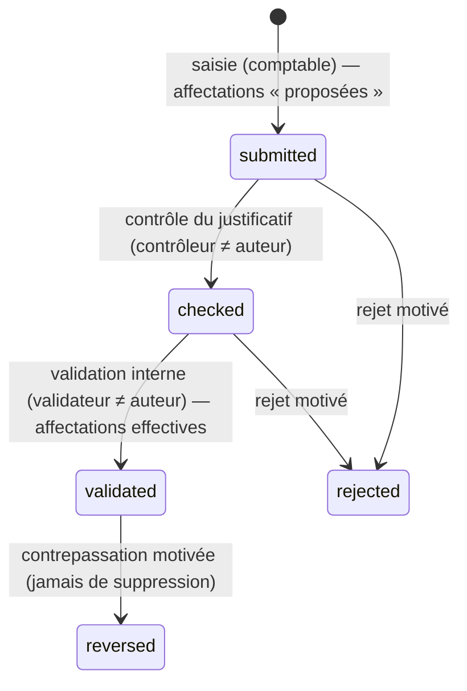

# 1. Besoins, hypothèses, rôles et règles financières

## 1.1 Synthèse des besoins

Karo gère le cycle complet des frais académiques et connexes d’une université : établissement des créances à partir des inscriptions et de barèmes versionnés, enregistrement des bordereaux bancaires présentés par les étudiants, contrôle et validation par des personnes distinctes, rapprochement avec les relevés bancaires, affectation aux frais, suivi des soldes, arriérés et excédents, contrats d’engagement, documents vérifiables, contrôle financier avant les examens, clôture des années, tableaux de bord, rapports, audit et fonctionnement sur le réseau local sans Internet.

## 1.2 Hypothèses retenues (décisions non bloquantes)

| # | Hypothèse | Conséquence |
|---|---|---|
| H1 | Un **serveur de référence unique** est installé dans l’université (réseau local) ; il est la seule autorité d’écriture. | Les postes déconnectés ne font que préparer des saisies provisoires. |
| H2 | Devises initiales **USD et CDF** ; d’autres peuvent être ajoutées. Aucun taux n’est préconfiguré. | Aucune opération entre devises tant qu’un taux n’est pas approuvé. |
| H3 | Un paiement concerne **un étudiant, une année académique, un compte bénéficiaire et une devise** (celle du compte). | Un versement couvrant plusieurs étudiants doit être saisi en plusieurs bordereaux (même relevé : rapprochement multiple). |
| H4 | Un règlement **validé** réduit le solde même s’il n’est pas encore confirmé par la banque ; la confirmation bancaire est affichée séparément. Le contrôle des examens peut exiger la confirmation bancaire (paramètre par session). | Distinction stricte « validé » / « confirmé ». |
| H5 | Une diminution de créance (bourse, exonération…) ne peut dépasser le **solde restant** : les montants déjà réglés ne sont libérés que par contrepassation. | Pas de trop-perçu implicite. |
| H6 | Les **arriérés** sont reportés à la clôture par un ajustement « report » sur la créance d’origine et une créance « reportée » dans l’année suivante, liées entre elles. | Aucun double comptage entre années. |
| H7 | Les **frais d’examens** sont établis à l’inscription à la session (génération collective ; pour le rattrapage, sur liste de matricules). | Pas de créance de rattrapage pour les étudiants non concernés. |
| H8 | Les **PDF** de relevés sont lus par extraction de texte locale ; les PDF scannés (images) nécessiteraient un OCR local **non fourni**. | Ils sont refusés avec un message explicite ; demander un CSV/Excel à la banque. |
| H9 | Pas d’envoi de courriel (réseau local) : la **récupération de compte** passe par les codes de récupération 2FA ou par l’administrateur technique. | Procédure documentée et auditée. |
| H10 | Les encaissements confirmés ne sont **pas des produits comptables** ; l’intégration à une comptabilité générale fera l’objet d’une spécification distincte. | Aucun module comptable n’est simulé. |
| H11 | Le skill « Sites » mentionné dans la demande n’était pas disponible dans l’environnement de réalisation. | L’interface est intégrée à l’application Laravel (Blade) et vérifiée dans Chromium. |

## 1.3 Rôles et matrice des permissions

Les rôles sont paramétrables (écran *Utilisateurs › Rôles × permissions*). Une **habilitation** associe un utilisateur, un rôle et un **périmètre** facultatif : une faculté et/ou une année académique (vide = toutes). Toutes les permissions sont contrôlées **côté serveur** : middleware sur chaque route, puis contrôle dans les services métier (défense en profondeur) et contrôle d’appartenance des dossiers (une URL forgée vers un étudiant hors périmètre renvoie 403).

Garde-fous :
- les permissions marquées « approbation » sont des **approbations financières** ; un rôle ou un compte ne peut pas cumuler l’**administration technique** (utilisateurs, rôles) et une approbation financière ;
- personne ne peut modifier **ses propres** habilitations, ni un rôle qui lui est attribué ;
- **séparation des tâches** (paramétrable, active par défaut) : l’auteur d’une saisie ne peut ni la contrôler ni la valider ; l’auteur d’un barème, d’un ajustement, d’une opération sur excédent ou d’un contrat ne peut pas l’approuver ;
- rôles à **double authentification obligatoire** (par défaut) : Recteur, Administrateur de budget, Contrôleur, Administrateur technique.

| Module | Permission | Approbation | Rect. | SGA | Budget | Saisie | Contr. | Tech. | Audit | Étud. |
|---|---|---|---|---|---|---|---|---|---|---|
| Tableau de bord et rapports | Voir le tableau de bord (`dashboard.view`) |  | ✔ | ✔ | ✔ | ✔ | ✔ |  | ✔ |  |
| Tableau de bord et rapports | Consulter les rapports (`reports.view`) |  | ✔ | ✔ | ✔ |  | ✔ |  | ✔ |  |
| Tableau de bord et rapports | Exporter les rapports (PDF, Excel) (`reports.export`) |  | ✔ | ✔ | ✔ |  |  |  | ✔ |  |
| Étudiants | Consulter les dossiers étudiants (`students.view`) |  | ✔ | ✔ | ✔ | ✔ | ✔ |  | ✔ |  |
| Étudiants | Créer et modifier les dossiers et inscriptions (`students.manage`) |  |  | ✔ |  | ✔ |  |  |  |  |
| Étudiants | Importer des étudiants (Excel) (`students.import`) |  |  | ✔ |  | ✔ |  |  |  |  |
| Frais et créances | Consulter frais, barèmes et tranches (`fees.view`) |  | ✔ | ✔ | ✔ | ✔ | ✔ |  | ✔ |  |
| Frais et créances | Préparer frais, barèmes et tranches (brouillons) (`fees.manage`) |  |  |  | ✔ |  |  |  |  |  |
| Frais et créances | Approuver et activer les barèmes (`fees.approve`) | oui |  |  | ✔ |  |  |  |  |  |
| Frais et créances | Générer les créances (`charges.generate`) |  |  |  | ✔ | ✔ |  |  |  |  |
| Frais et créances | Créer ou annuler une créance manuelle (`charges.manage`) |  |  |  | ✔ |  |  |  |  |  |
| Frais et créances | Demander bourse, réduction, exonération, ajustement (`adjustments.request`) |  |  |  | ✔ | ✔ |  |  |  |  |
| Frais et créances | Approuver bourses, réductions et ajustements (`adjustments.approve`) | oui |  |  | ✔ |  |  |  |  |  |
| Paiements | Consulter les paiements (`payments.view`) |  | ✔ |  | ✔ | ✔ | ✔ |  | ✔ |  |
| Paiements | Saisir les bordereaux (`payments.create`) |  |  |  |  | ✔ |  |  |  |  |
| Paiements | Contrôler les justificatifs (`payments.check`) |  |  |  |  |  | ✔ |  |  |  |
| Paiements | Valider les paiements (affectation effective) (`payments.validate`) | oui |  |  | ✔ |  | ✔ |  |  |  |
| Paiements | Contrepasser un paiement validé (`payments.reverse`) | oui |  |  | ✔ |  |  |  |  |  |
| Paiements | Demander compensation, remboursement ou report (`credits.request`) |  |  |  | ✔ | ✔ |  |  |  |  |
| Paiements | Approuver l’utilisation des excédents (`credits.approve`) | oui |  |  | ✔ |  |  |  |  |  |
| Banque et rapprochement | Importer les relevés bancaires (`bank.import`) |  |  |  |  | ✔ |  |  |  |  |
| Banque et rapprochement | Vérifier les lignes de relevé incertaines (`bank.review`) |  |  |  | ✔ |  | ✔ |  |  |  |
| Banque et rapprochement | Rapprocher relevés et paiements (`bank.reconcile`) | oui |  |  | ✔ |  | ✔ |  |  |  |
| Contrats et documents | Consulter les contrats (`contracts.view`) |  | ✔ |  | ✔ | ✔ | ✔ |  | ✔ |  |
| Contrats et documents | Préparer les contrats et nouvelles versions (`contracts.manage`) |  |  |  | ✔ | ✔ |  |  |  |  |
| Contrats et documents | Approuver et archiver les contrats signés (`contracts.approve`) | oui |  |  | ✔ |  |  |  |  |  |
| Contrats et documents | Émettre reçus, relevés et attestations (`documents.issue`) |  |  |  | ✔ | ✔ | ✔ |  |  |  |
| Examens | Consulter le contrôle financier des examens (`exams.view`) |  | ✔ | ✔ | ✔ | ✔ | ✔ |  | ✔ |  |
| Examens | Paramétrer les conditions des sessions (`exams.manage`) |  |  | ✔ |  |  |  |  |  |  |
| Examens | Enregistrer une dérogation exceptionnelle (`exams.waive`) | oui |  |  | ✔ |  |  |  |  |  |
| Années académiques | Créer et ouvrir les années, sessions et semestres (`years.manage`) |  |  | ✔ |  |  |  | ✔ |  |  |
| Années académiques | Clôturer une année académique (`years.close`) | oui |  |  | ✔ |  |  |  |  |  |
| Années académiques | Rouvrir une année clôturée (exceptionnel) (`years.reopen`) | oui |  |  | ✔ |  |  |  |  |  |
| Paramètres | Gérer facultés, départements, filières, promotions (`structure.manage`) |  |  |  |  |  |  | ✔ |  |  |
| Paramètres | Gérer banques, comptes, devises (`finance_settings.manage`) |  |  |  | ✔ |  |  |  |  |  |
| Paramètres | Approuver un taux de conversion (`rates.approve`) | oui |  |  | ✔ |  |  |  |  |  |
| Paramètres | Paramètres institutionnels et numérotation (`settings.manage`) |  |  |  | ✔ |  |  | ✔ |  |  |
| Administration technique | Gérer les utilisateurs (`users.manage`) |  |  |  |  |  |  | ✔ |  |  |
| Administration technique | Gérer les rôles et permissions (`roles.manage`) |  |  |  |  |  |  | ✔ |  |  |
| Administration technique | Sauvegardes et maintenance (`backups.manage`) |  |  |  |  |  |  | ✔ |  |  |
| Administration technique | Consulter le journal d’audit (`audit.view`) |  | ✔ |  | ✔ |  |  | ✔ | ✔ |  |
| Administration technique | Préparer des saisies hors connexion (`sync.use`) |  |  |  |  | ✔ |  |  |  |  |
| Administration technique | Traiter les conflits de synchronisation (`sync.resolve`) |  |  |  | ✔ |  | ✔ |  |  |  |
| Portail étudiant | Consulter son propre compte (`student.self`) |  |  |  |  |  |  |  |  | ✔ |

## 1.4 Statuts et circuits

### Paiement (bordereau)

Axe **indépendant** de confirmation bancaire : `unconfirmed` → `partial` → `confirmed` selon les montants rapprochés avec des lignes de relevé ; `not_applicable` pour un report d’excédent. Un justificatif présenté par l’étudiant ne vaut jamais confirmation bancaire.

### Autres circuits
| Objet | Circuit |
|---|---|
| Barème | brouillon (fees.manage) → actif (fees.approve, autre personne) ; nouvelle version → l’ancienne passe « remplacée » mais reste applicable avant la date d’effet de la nouvelle |
| Ajustement (bourse, réduction, exonération, prise en charge, hausse/baisse) | en attente → approuvé / rejeté (justificatif obligatoire pour bourse, exonération, prise en charge) |
| Opération sur excédent (compensation, remboursement, report) | en attente (montant **réservé**) → exécutée / rejetée |
| Ligne de relevé | fiable ou **à vérifier** (PDF, référence absente, date de valeur illisible) → vérifiée / rejetée ; puis non rapprochée → partiellement → rapprochée, ou écartée (motif) |
| Contrat | brouillon → approuvé → signé (version signée archivée) ; toute modification → nouvelle version, l’ancienne « remplacée » |
| Document | provisoire / définitif / annulé (annulé automatiquement à la vérification si le paiement a été contrepassé) |
| Année | planifiée → ouverte → clôturée ; réouverture exceptionnelle motivée (≥ 10 caractères) et auditée |
| Opération synchronisée | acceptée (paiement « soumis ») / rejetée / en conflit (décision humaine) |

## 1.5 Règles financières et formules

Toutes les sommes sont calculées **par devise** et ne sont jamais additionnées entre devises. Arithmétique décimale exacte (`brick/math`, colonnes `DECIMAL(15,2)`), aucun nombre flottant.

| Grandeur | Formule |
|---|---|
| Net dû d’une créance | montant du barème − Σ ajustements **approuvés** (positif = diminution, négatif = hausse) |
| Réglé d’une créance | Σ affectations **effectives** de paiements **validés** (convertis dans la devise de la créance si un taux approuvé a été utilisé) |
| Solde dû | Σ par créance de max(0, net − réglé) |
| Exigible / retard | Σ par créance de max(0, min(net, tranches échues) − réglé) ; > 0 ⇒ en retard |
| Paiements en attente | Σ paiements soumis ou contrôlés |
| Confirmé par la banque | Σ montants rapprochés avec des lignes de relevé |
| Disponible d’un paiement (crédit) | montant − affectations proposées/effectives − remboursements et reports (en attente ou exécutés) − compensations en attente |
| Taux de recouvrement | affecté ÷ attendu × 100 |

Règles :
- **RF1** Un versement réparti entre plusieurs frais reste **un seul paiement** ; le total affecté ne peut dépasser le montant reçu ; le reste est conservé comme crédit.
- **RF2** Une affectation ne peut dépasser le solde de la créance ; le contrôle est **refait à la validation** sous verrou (deux paiements proposés sur la même créance ne peuvent pas être validés tous les deux au-delà du solde).
- **RF3** Détections automatiques : référence bancaire déjà utilisée (comparaison normalisée), doublon probable (même étudiant, compte, montant, date), justificatif manquant, devise incohérente avec le compte (bloquant), compte non autorisé pour le frais (bloquant), affectation supérieure au montant (bloquant). Une anomalie non bloquante doit être **explicitement examinée** par le validateur.
- **RF4** Clé d’idempotence (UUID) sur chaque saisie, demande d’excédent, créance manuelle et opération synchronisée : un double clic, une re-tentative réseau ou une resynchronisation ne crée jamais de doublon.
- **RF5** Un crédit ne peut être utilisé deux fois : la ligne du paiement source est verrouillée à la demande et à l’approbation ; une demande en attente réserve le montant.
- **RF6** Pas de compensation entre devises sans **taux approuvé et enregistré** (date d’effet, source, approbateur) ; le taux utilisé est conservé sur l’affectation.
- **RF7** Une opération validée se corrige par **contrepassation** ou ajustement tracé ; rien n’est supprimé. La contrepassation annule les affectations et les rapprochements, et rend caducs les documents émis.
- **RF8** Les barèmes sont résolus par spécificité (promotion > filière, faculté, cycle, statut > général) ; deux barèmes de même précision qui s’appliquent ⇒ refus (ambiguïté). Les tranches doivent totaliser le montant (100 % en pourcentage, l’écart d’arrondi est porté sur la dernière tranche).
- **RF9** La génération des créances est idempotente (clé unique inscription × frais × session) ; le stock de créances ne dépend jamais du nombre de générations.
- **RF10** Clôture : bloquée tant qu’il reste des paiements, ajustements ou opérations sur excédent en attente, ou des conflits de synchronisation ; reports d’arriérés et de crédits sans duplication (clés déterministes) ; ensuite toute écriture ordinaire sur l’année est refusée par un point de contrôle unique (`YearGuard`) utilisé par l’interface, l’API et la synchronisation.

## 1.6 Rapprochement bancaire : critères et tolérances

| Critère | Points | Remarque |
|---|---|---|
| Même compte et même devise | obligatoire | sinon aucun candidat |
| Référence normalisée identique (majuscules, sans espaces ni ponctuation) | 50 | |
| Montant égal au reste non confirmé | 30 | |
| Date d’opération à ± N jours de la date de versement | 20 | N paramétrable (3 par défaut) |

- **Correspondance exacte** = référence + montant + date. Elle n’est appliquée automatiquement que si elle est **unique** et que la ligne est fiable ou vérifiée.
- **Cas ambigu** (plusieurs paiements exacts) : aucune application automatique ; le choix manuel exige un commentaire.
- **Partiel / multiple** : une ligne peut confirmer plusieurs paiements (dépôt groupé) et un paiement plusieurs lignes ; un rapprochement partiel exige un commentaire ; jamais au-delà des restes.
- **Chevauchement des relevés** : chaque ligne a une empreinte (compte, date, montant, référence, libellé, rang d’occurrence dans le fichier) ; une ligne déjà connue n’est pas réimportée ; un fichier identique est refusé.
- **Rapport** : couverture des relevés par compte (périodes non couvertes), lignes rapprochées / partielles (écarts) / non rapprochées / à vérifier / écartées, paiements validés non confirmés, anomalies.

## 1.7 Contrôle financier des examens

Par session : frais retenus, seuil (% du requis), échéance (seules les tranches échues à cette date sont exigées), exigence de confirmation bancaire. Statuts : **en règle**, **partiellement en règle**, **solde dû**, **autorisation exceptionnelle** (dérogation avec session, motif, autorité, date, validité). Ce contrôle ne vaut pas admissibilité académique ; la mention figure sur les écrans, exports et attestations.
