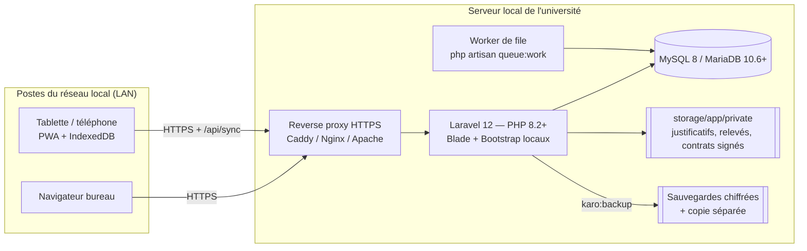
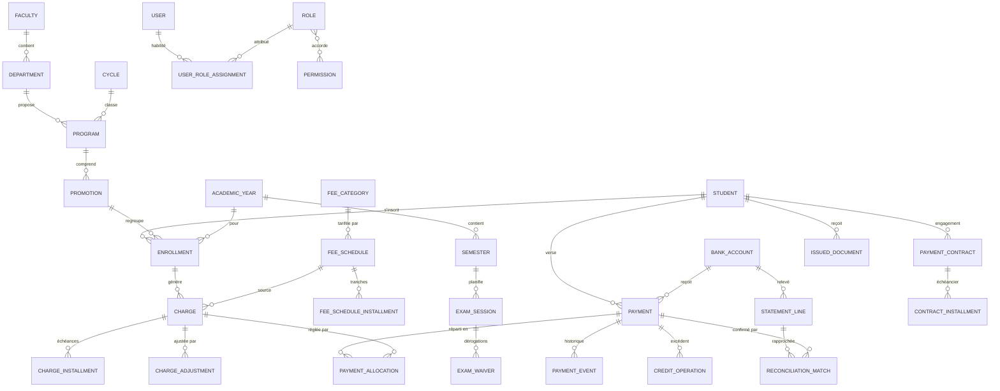

# 02 — Architecture technique et modèle de données

## 1. Architecture

Principes :

* **Monolithe Laravel** rendu côté serveur (Blade). Aucune dépendance Internet : CSS, JS,
  polices, icônes et graphiques sont servis depuis `public/` ; la politique CSP est `default-src 'self'`.
* **Couche services** (`app/Services`) : toute règle financière y est appliquée ; les contrôleurs
  ne font que valider l'entrée et appeler les services. Chaque service revérifie l'autorisation
  (`App\Support\Authz::need`) — l'interface n'est jamais la seule barrière.
* **Point de contrôle unique de clôture** : `YearGuard::assertWritable()` est appelé par toute
  écriture (paiement, créance, ajustement, crédit, barème, contrat, document, synchronisation).
* **Transactions + verrous** (`lockForUpdate`) sur paiements, créances et opérations de crédit ;
  idempotence par `client_uuid` unique et par clés d'unicité (`charges.uniqueness_key`,
  `statement_lines.fingerprint`).
* **Journal d'audit chaîné** (`audit_logs.previous_hash` → `hash` SHA-256) ; le modèle interdit
  `update`/`delete` et `php artisan karo:audit-verify` détecte toute altération.

### Organisation du code

| Dossier | Contenu |
|---|---|
| `app/Models` | 41 modèles Eloquent |
| `app/Services` | Règles métier (paiements, rapprochement, crédits, clôture, import, synchronisation, sauvegarde…) |
| `app/Support` | Monnaie exacte (`Money`, brick/math), paramètres, registre des permissions, libellés, lecture Excel/CSV |
| `app/Http/Controllers` | 24 contrôleurs fins |
| `app/Http/Middleware` | En-têtes de sécurité, compte actif, 2FA/mot de passe temporaire, `perm:` |
| `database/migrations` | Schéma complet (12 migrations) |
| `database/seeders` | Configuration initiale (rôles, permissions, devises, catégories) et démo séparée |
| `resources/views` | Écrans Blade |
| `resources/pwa/sw.js` | Service worker (servi à `/sw.js`) |
| `public/js/offline.js` | File locale IndexedDB et synchronisation |
| `tests/Feature` | 44 tests d'acceptation |

## 2. Séparation des notions financières

Le modèle distingue strictement, par des tables différentes :

| Notion | Table | Qui | Remarque |
|---|---|---|---|
| **Créance** (montant dû) | `charges`, `charge_installments` | générée par barème approuvé | clé d'unicité étudiant+année+catégorie(+session) |
| **Ajustement** (bourse, réduction, exonération, annulation partielle) | `charge_adjustments` | proposé puis approuvé par un tiers | montant signé, jamais modification de la créance |
| **Preuve** | fichier privé + `payments.proof_path`, `proof_sha256` | comptable de saisie | servi uniquement via contrôleur autorisé |
| **Paiement déclaré** (bordereau) | `payments` | comptable de saisie | un versement = un paiement, même réparti |
| **Contrôle / validation** | `payments.status` + `payment_events` | contrôleur, validateur | séparation des personnes paramétrable |
| **Confirmation bancaire** | `payments.bank_status` | via rapprochement | indépendante de la validation |
| **Rapprochement** | `statement_lines`, `reconciliation_matches` | contrôleur | ligne de relevé ↔ paiement(s) |
| **Affectation** | `payment_allocations` | proposée à la saisie, activée à la validation | `proposed` → `active` → `reversed` |
| **Excédent / crédit** | `credit_operations` | compensation, remboursement, report, conservation | jamais réutilisé deux fois |

### Dates

* `payments.deposit_date` : **date bancaire** (date du bordereau / de valeur).
* `payments.created_at`, `submitted_at`, `checked_at`, `validated_at` : **dates techniques** de saisie et de circuit.
* `statement_lines.operation_date` / `value_date` : dates du relevé.
* Tous les horodatages sont en `Africa/Lubumbashi` (configurable, `config/app.php`).

## 3. Modèle conceptuel (simplifié)

## 4. Modèle logique (tables principales)

| Domaine | Tables | Contraintes clés |
|---|---|---|
| Configuration | `settings`, `document_sequences`, `currencies`, `exchange_rates`, `banks`, `bank_accounts`, `bank_account_fee_category` | taux de change avec statut d'approbation ; comptes autorisés par catégorie et devise |
| Structure | `faculties`, `departments`, `cycles`, `programs`, `promotions` (`is_final`), `academic_years` (`planned/open/closed`, `previous_year_id`), `semesters`, `exam_sessions` | une seule année `is_current` |
| Habilitations | `users`, `roles` (`requires_2fa`), `permissions` (`module`, `is_sensitive`), `permission_role`, `user_role_assignments` (`faculty_id`, `academic_year_id` facultatifs) | périmètre par faculté/année |
| Étudiants | `students` (matricule unique), `enrollments` (unique étudiant+année), `student_documents`, `import_batches` | réimport sans doublon par matricule |
| Tarification | `fee_categories` (nature, déclencheur, statuts, finalistes, semestre/session), `fee_schedules` (version, `replaces_id`, critères JSON, statut), `fee_schedule_installments` | somme des tranches = montant (vérifiée à l'approbation) |
| Créances | `charges` (`uniqueness_key` unique, `origin`), `charge_installments`, `charge_adjustments` | pas de doublon, ajustements signés |
| Paiements | `payments` (`client_uuid` unique, `status`, `bank_status`, `anomalies`, `channel`), `payment_events`, `payment_allocations`, `credit_operations` (`client_uuid` unique) | Σ affectations ≤ montant ; contrepassation au lieu de suppression |
| Banque | `statement_lines` (`fingerprint` unique, `review_status`, `match_status`), `reconciliation_matches` | relevés chevauchants dédupliqués |
| Contrats & documents | `payment_contracts` (numéro+version unique), `contract_installments`, `issued_documents` (`verification_token`, résumé public minimal), `exam_waivers` | |
| Traçabilité | `audit_logs` (chaîne de hachage), `sync_operations`, `devices` | journal non modifiable |

Le détail exact (types, index) est dans `database/migrations/`.

## 5. Versions et compatibilité

| Composant | Version utilisée / testée | Compatibilité visée |
|---|---|---|
| PHP | 8.3.6 (tests) ; plateforme Composer figée à 8.2.12 | PHP 8.2, 8.3 |
| Laravel | 12.x | — |
| Base de données | SQLite (tests et démo) | MySQL 8.0+ / MariaDB 10.6+ (cible production, **non exécutée dans cet environnement**) |
| barryvdh/laravel-dompdf | 3.1 | PDF des contrats, reçus, listes, rapports |
| openspout/openspout | 4.28 | lecture/écriture Excel (XLSX) et CSV |
| bacon/bacon-qr-code | 3.1 | QR codes SVG (vérification des documents) |
| smalot/pdfparser | 2.13 | extraction locale du texte des relevés PDF |
| brick/math | via Laravel | calculs décimaux exacts |
| Bootstrap / Bootstrap Icons / Chart.js | 5.3.3 / 1.11.3 / 4.4.4 | copiés localement dans `public/vendor` |
| Navigateurs | Chromium (tests Playwright) | navigateurs récents ; PWA nécessite HTTPS (ou `localhost`) |
