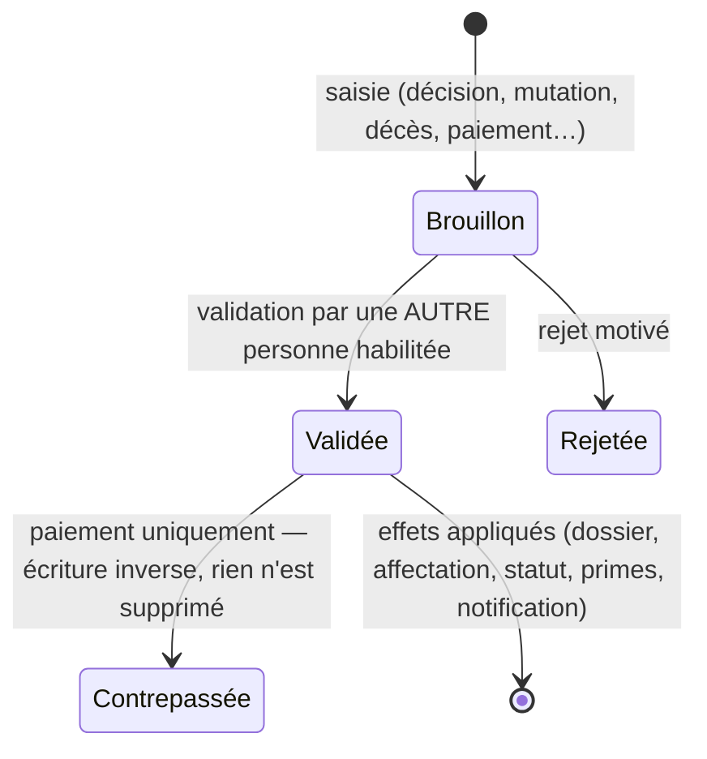

# 01 — Besoins, hypothèses et règles de gestion

## 1. Synthèse

UNILU-GRH centralise le dossier unique de chaque agent (académique, scientifique, administratif et ouvrier) et
trace toute sa vie professionnelle : carrière et promotions, diplômes et production scientifique, affectations,
mutations, congés et situations administratives, décès, primes et acomptes, soutiens sociaux, recrutement ; il gère
aussi le patrimoine immobilier et mobilier de l'université. Toute décision repose sur une référence officielle et
produit une trace ; rien n'est jamais effacé.

## 2. Hypothèses retenues (choix non bloquants)

| N° | Hypothèse | Où la modifier |
|---|---|---|
| H1 | **Prorata journalier** : le droit à une prime d'une période = taux × (Σ coefficients journaliers / nombre de jours). Un jour vaut 0 avant l'engagement et à partir de la date de fin des droits ; sinon le plus petit « % de primes » des situations approuvées qui le couvrent (100 % par défaut). Un type de prime peut être déclaré « non prorata » : le coefficient du premier jour s'applique alors à toute la période. | Paramétrage › Types de primes |
| H2 | **% de primes par situation** livrés à l'installation (à valider par l'administration) : congés annuel, maladie, maternité, exceptionnel = 100 % ; mise en disponibilité, suspensions administrative et disciplinaire = 0 % ; retraite, démission, départ = fin des droits. | Paramétrage › Types de congés et situations |
| H3 | **Date d'effet** : pour un décès, une mutation externe ou une fin de fonctions, les primes sont acquises jusqu'à la veille de la date d'effet incluse ; aucune nouvelle prime n'est générée pour une période commençant à cette date ou après. | Code (`PrimeService`) |
| H4 | **Aucun montant codé en dur** : aucun taux de prime ni montant d'aide n'est livré en production ; tant que l'administration ne les a pas définis, aucune prime n'est générée (l'agent est compté « sans taux »). | Taux de primes, Degrés de parenté |
| H5 | **Taux immuables** : un taux enregistré n'est pas modifié (seules sa validité et son activation changent) ; un nouveau montant = nouveau taux. Les droits déjà générés ne sont jamais recalculés silencieusement. | — |
| H6 | **Devises** : chaque taux et chaque aide porte sa devise ; les totaux sont présentés par devise, jamais additionnés entre devises. | — |
| H7 | **« Docteur »** est un grade académique (qualification) et non un grade administratif : « Chef de travaux → docteur » s'enregistre comme décision « Obtention du doctorat » et/ou qualification « Grade académique de docteur ». | — |
| H8 | **Mandats d'assistant** : premier et deuxième mandats livrés **sans durée** (réglementation à confirmer) ; la date de fin est saisie dans la décision ou calculée si une durée est paramétrée. Alerte 90 jours avant l'échéance. | Paramétrage › Mandats ; `.env` GRH_ALERT_DAYS_MANDATE |
| H9 | **Catégorie administrative des assistants de recherche** (ex. Chef de bureau) : elle est choisie parmi les grades de la famille administrative et reste distincte de la fonction scientifique. | Paramétrage › Grades |
| H10 | **Validation par une autre personne** (séparation des tâches) pour : décisions de carrière, mutations, situations, décès, paiements et acomptes, soutiens sociaux (approbation par une autre personne que le demandeur, paiement par une autre personne que l’approbateur), validation des candidatures. Désactivable dans les paramètres (déconseillé). | Paramétrage › Institution |
| H11 | **Une seule affectation principale active** par agent : une nouvelle affectation principale clôture la précédente la veille de son début (paramètre « plusieurs affectations principales » pour l'exception). Les affectations secondaires sont possibles. | Paramétrage › Institution |
| H12 | Après un décès, le paiement des sommes restant dues exige d'indiquer l'**ayant droit** (texte libre) ; la procédure successorale elle-même reste hors application. | — |
| H13 | **Demandes de correction** : les rubriques d'identité et de contact acceptées sont appliquées automatiquement (historisées) ; les autres (diplôme, carrière…) sont traitées manuellement par le gestionnaire. | — |
| H14 | **Notifications** : toujours dans l'application pour les agents ayant un compte ; par courriel si une adresse est connue et un serveur SMTP configuré. Un échec d'envoi ne bloque jamais l'opération. | `.env` MAIL_*, GRH_MAIL_NOTIFICATIONS |
| H15 | **Nom et sigle** de l'établissement, en-têtes et signataires des éditions sont des paramètres (le sigle « UNILU » demandé est livré par défaut). | Paramétrage › Institution |
| H16 | Le cahier des charges reçu s'interrompt à la règle 9 de la section 22 (« Les primes déjà acquises ne doivent jamais être effac… ») ; elle est comprise comme « jamais effacées » et appliquée (droits et paiements non supprimables, corrections par ajustement, contrepassation ou régularisation). Les éventuelles règles suivantes n'ont pas pu être prises en compte. | — |

## 3. Règles de gestion essentielles (section 22) et leur mise en œuvre

| Règle | Mise en œuvre | Test |
|---|---|---|
| 1. Matricule unique | Contrainte unique en base + contrôle métier ; attribution automatique `UNILU-AAAA-NNNNN` à l'engagement si non saisi | `test_matricule_unique`, `test_matricule_attribue_automatiquement` |
| 2. Affectations successives, une seule principale active (sauf configuration) | `AssignmentService` clôture l'affectation principale précédente ; contrôle des places d'un poste | `test_une_seule_affectation_principale_active_et_postes` |
| 3. Promotion justifiée par une décision officielle | Numéro, date, autorité obligatoires ; brouillon → validation par un tiers ; aucun effet avant validation | `test_promotion_justifiee_par_decision_et_validee_par_un_tiers` |
| 4. Mutation avec date d'effet | Date d'effet obligatoire ; validation par un tiers | `test_mutation_sans_date_d_effet_refusee_et_validation_par_un_tiers` |
| 5. Suspension avec durée et justification | Date de fin et motif obligatoires selon le type ; durée calculée | `test_suspension_avec_duree_et_justification_puis_reintegration` |
| 6. Conséquences financières paramétrables des situations | « % de primes », clôture d'affectation, fin des droits par type de situation ; recalcul des droits déjà générés | `test_regles_de_situation_suspension_et_conge`, `test_disponibilite_cloture_l_affectation_et_prolongation` |
| 7. Décès : arrêt des nouvelles primes à la date d'effet | Statut « Décédé », affectation clôturée, fin des droits, recalcul (ajustements), instantané financier, soutien social ouvert, paiements ordinaires bloqués | `test_deces_retroactif_trop_percu_regularisation_et_arret_des_primes`, `test_deces_statut_affectation_soutien_et_dossier_conserve`, `test_paiement_apres_deces_exige_un_ayant_droit` |
| 8. Mutation externe : clôture des droits ordinaires | Affectation clôturée, statut « Muté vers une autre institution », recalcul, instantané financier ; la mutation interne maintient les droits | `test_mutation_externe_cloture_les_droits_et_conserve_le_dossier`, `test_mutation_interne_maintient_les_droits` |
| 9. Primes acquises jamais effacées | Droits, paiements, décisions, dossiers non supprimables (exception levée) ; ajustement signé, contrepassation, régularisation | `test_contrepassation_sans_suppression` |

## 4. Formules financières

| Réf. | Formule |
|---|---|
| RF1 | Taux applicable = taux actif du type de prime dont les critères renseignés (famille, catégorie, grade, fonction, unité ou unité parente, année académique) correspondent tous à l'agent, en retenant celui qui en a le plus |
| RF2 | Coefficient du jour *j* = 0 si *j* < engagement ou *j* ≥ fin des droits ; sinon min(% des situations approuvées couvrant *j*, 100) |
| RF3 | Montant calculé = taux × Σ coefficients / (100 × jours de la période), arrondi au centime (demi supérieur) |
| RF4 | Prévu net = montant calculé + Σ ajustements |
| RF5 | Payé = Σ mouvements validés ou contrepassés + contrepassations (signés) |
| RF6 | Solde = prévu net − payé ; solde négatif = **trop-perçu** à régulariser |
| RF7 | Acompte : 0 < montant ≤ solde − mouvements en attente ; le paiement du solde propose automatiquement « solde restant » (acomptes déduits) |
| RF8 | Arriérés = Σ soldes positifs des périodes terminées ; acompte non régularisé = acompte validé sur un droit dont le solde reste positif |
| RF9 | Aide au deuil = montant paramétré du degré de parenté (ou montant par défaut du type), plafonné au plafond du type |

## 5. Rôles et permissions (configuration livrée)

Chaque rôle peut être attribué avec un **périmètre** : une unité organisationnelle (et toutes ses sous-unités) et/ou une
famille de personnel. Les permissions des rôles se modifient dans « Rôles et permissions ».

| Permission | Module | SA | ARH | GP | RPA | RPS | GF | RPat | RF | RS | AG |
|---|---|---|---|---|---|---|---|---|---|---|---|
| Consulter le tableau de bord (`dashboard.view`) | Pilotage | ✓ | ✓ | ✓ | ✓ | ✓ | ✓ |  | ✓ | ✓ |  |
| Éditer les listes et états du personnel (`reports.view`) | Pilotage | ✓ | ✓ | ✓ | ✓ | ✓ | ✓ |  | ✓ | ✓ |  |
| Éditer les états financiers (primes, acomptes, arriérés, soutiens) ⚠ (`reports.finance`) | Pilotage | ✓ |  |  |  |  | ✓ |  |  |  |  |
| Annuaire minimal (matricule, nom, unité) (`employees.directory`) | Personnel | ✓ | ✓ | ✓ | ✓ | ✓ | ✓ | ✓ | ✓ | ✓ |  |
| Consulter les dossiers du personnel (`employees.view`) | Personnel | ✓ | ✓ | ✓ | ✓ | ✓ | ✓ |  | ✓ | ✓ |  |
| Créer et modifier les dossiers du personnel ⚠ (`employees.manage`) | Personnel | ✓ | ✓ | ✓ | ✓ | ✓ |  |  |  |  |  |
| Gérer les pièces numérisées des dossiers ⚠ (`employees.documents`) | Personnel | ✓ | ✓ | ✓ | ✓ | ✓ |  |  |  |  |  |
| Consulter l’historique des modifications (`employees.history`) | Personnel | ✓ | ✓ | ✓ | ✓ | ✓ |  |  | ✓ |  |  |
| Consulter et modifier les coordonnées bancaires ⚠ (`employees.bank`) | Personnel | ✓ |  |  |  |  | ✓ |  |  |  |  |
| Traiter les demandes de correction des agents ⚠ (`corrections.handle`) | Personnel | ✓ | ✓ | ✓ |  |  |  |  |  |  |  |
| Préparer nominations et promotions ⚠ (`career.manage`) | Carrière | ✓ | ✓ | ✓ | ✓ | ✓ |  |  |  |  |  |
| Valider nominations et promotions ⚠ (`career.validate`) | Carrière | ✓ | ✓ |  |  |  |  |  |  |  |  |
| Gérer diplômes et travaux scientifiques (`qualifications.manage`) | Carrière | ✓ | ✓ | ✓ | ✓ | ✓ |  |  |  |  |  |
| Gérer la structure organisationnelle et les postes ⚠ (`structure.manage`) | Organisation | ✓ | ✓ |  |  |  |  |  |  |  |  |
| Enregistrer les affectations ⚠ (`assignments.manage`) | Organisation | ✓ | ✓ | ✓ |  |  |  |  |  |  |  |
| Préparer les mutations ⚠ (`mutations.manage`) | Mouvements | ✓ | ✓ | ✓ |  |  |  |  |  |  |  |
| Valider les mutations ⚠ (`mutations.validate`) | Mouvements | ✓ | ✓ |  |  |  |  |  |  |  |  |
| Enregistrer congés et situations administratives ⚠ (`situations.manage`) | Mouvements | ✓ | ✓ | ✓ | ✓ | ✓ |  |  | ✓ | ✓ |  |
| Valider congés, suspensions et disponibilités ⚠ (`situations.validate`) | Mouvements | ✓ | ✓ |  |  |  |  |  |  |  |  |
| Enregistrer un décès ⚠ (`deaths.manage`) | Mouvements | ✓ | ✓ | ✓ |  |  |  |  |  |  |  |
| Valider un décès ⚠ (`deaths.validate`) | Mouvements | ✓ | ✓ |  |  |  |  |  |  |  |  |
| Consulter la cause d’un décès ⚠ (`deaths.cause`) | Mouvements | ✓ | ✓ |  |  |  |  |  |  |  |  |
| Gérer les candidatures ⚠ (`recruitment.manage`) | Recrutement | ✓ | ✓ | ✓ |  |  |  |  |  |  |  |
| Prononcer l’engagement et attribuer le matricule ⚠ (`recruitment.engage`) | Recrutement | ✓ | ✓ |  |  |  |  |  |  |  |  |
| Consulter les primes et paiements individuels ⚠ (`primes.view`) | Finances | ✓ |  |  |  |  | ✓ |  |  |  |  |
| Paramétrer types et taux de primes ⚠ (`primes.configure`) | Finances | ✓ |  |  |  |  | ✓ |  |  |  |  |
| Générer les droits à primes d’une période ⚠ (`primes.generate`) | Finances | ✓ |  |  |  |  | ✓ |  |  |  |  |
| Saisir paiements, acomptes et régularisations ⚠ (`payments.create`) | Finances | ✓ |  |  |  |  | ✓ |  |  |  |  |
| Valider ou contrepasser les paiements ⚠ (`payments.validate`) | Finances | ✓ |  |  |  |  | ✓ |  |  |  |  |
| Enregistrer les demandes de soutien social ⚠ (`social.manage`) | Social | ✓ | ✓ | ✓ |  |  |  |  |  |  |  |
| Approuver les soutiens sociaux ⚠ (`social.approve`) | Social | ✓ | ✓ |  |  |  |  |  |  |  |  |
| Enregistrer le paiement des soutiens sociaux ⚠ (`social.pay`) | Social | ✓ |  |  |  |  | ✓ |  |  |  |  |
| Consulter le patrimoine (`assets.view`) | Patrimoine | ✓ |  |  |  |  |  | ✓ | ✓ | ✓ |  |
| Gérer les biens et leurs mouvements ⚠ (`assets.manage`) | Patrimoine | ✓ |  |  |  |  |  | ✓ |  |  |  |
| Conduire les inventaires ⚠ (`inventories.manage`) | Patrimoine | ✓ |  |  |  |  |  | ✓ |  |  |  |
| Paramétrer les référentiels RH (années, grades, types…) ⚠ (`settings.manage`) | Administration | ✓ | ✓ |  |  |  |  |  |  |  |  |
| Gérer les comptes et les habilitations ⚠ (`users.manage`) | Administration | ✓ |  |  |  |  |  |  |  |  |  |
| Modifier les permissions des rôles ⚠ (`roles.manage`) | Administration | ✓ |  |  |  |  |  |  |  |  |  |
| Consulter le journal d’audit et des connexions ⚠ (`audit.view`) | Administration | ✓ | ✓ |  |  |  |  |  |  |  |  |
| Gérer les sauvegardes ⚠ (`backups.manage`) | Administration | ✓ |  |  |  |  |  |  |  |  |  |
| Créer des jetons d’accès à l’API ⚠ (`api.tokens`) | Administration | ✓ |  |  |  |  |  |  |  |  |  |
| Accéder à son espace personnel (`self.view`) | Espace personnel | ✓ | ✓ | ✓ | ✓ | ✓ | ✓ | ✓ | ✓ | ✓ | ✓ |

Légende : SA = Super administrateur · ARH = Administrateur RH · GP = Gestionnaire du personnel · RPA = Responsable du personnel académique · RPS = Responsable du personnel scientifique · GF = Gestionnaire financier · RPat = Responsable du patrimoine · RF = Responsable de faculté · RS = Responsable de service · AG = Agent du personnel. ⚠ = permission sensible.

Exemples demandés et vérifiés :
- le **gestionnaire financier** gère primes et paiements mais ne peut pas proposer ni valider de changement de grade (`test_gestionnaire_financier_ne_modifie_pas_les_grades`) ;
- le **responsable du patrimoine** gère les biens sans accès aux dossiers ni aux données financières individuelles (`test_cloisonnement_des_acces`) ;
- l'**agent** consulte son propre dossier, sans pouvoir modifier une décision (demande de correction uniquement) ;
- le **responsable de faculté** ne voit que les agents de sa faculté et de ses départements (`test_perimetres_faculte_et_famille`).

## 6. Circuits de décision

Situations administratives : demandée → approuvée (effets) → clôturée/réintégration, ou prolongée (nouvelle
demande liée). Candidatures : déposée → en examen → validée → engagée (matricule, affectation, fichier général).
Soutiens : demandé → approuvé → payé.
