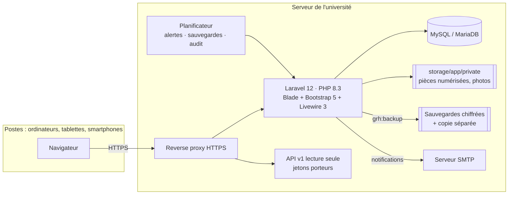
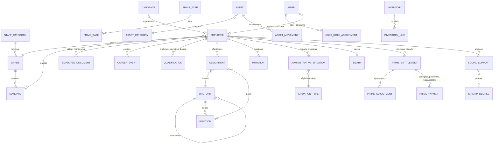

# 02 — Architecture technique

## 1. Vue d'ensemble

Architecture MVC avec une **couche de services** : les contrôleurs valident les entrées et délèguent ; chaque règle
de gestion vit dans un service (`app/Services`), qui revérifie l'habilitation et le périmètre (défense en profondeur).

| Dossier | Contenu |
|---|---|
| `app/Models` | 42 modèles Eloquent ; traits `Undeletable` (suppression interdite) et `RecordsChanges` (historique champ par champ) |
| `app/Services` | Dossiers, carrière, affectations, mutations, situations, décès, primes, social, recrutement, patrimoine, corrections, statistiques, éditions, alertes, notifications, sauvegardes, audit |
| `app/Livewire` | Fichier du personnel interactif (`EmployeeDirectory`), cloche de notifications (`NotificationBell`) |
| `app/Http/Controllers` | 27 contrôleurs fins, dont `Api/V1Controller` |
| `app/Support` | Registre des permissions et rôles, libellés, paramètres, arithmétique décimale exacte (`Money`) |
| `database/migrations` | Schéma complet (8 migrations) |
| `database/seeders` | Configuration initiale (rôles, référentiels sans montants) et démonstration fictive séparée |
| `resources/views` | Écrans Blade, modèles PDF (en-tête institutionnel, références, signatures) |
| `tests/Feature` | 37 tests (services, parcours HTTP, écrans, sécurité, API) |

## 2. Modèle de données

Tables transverses : `audit_logs` (journal chaîné), `record_changes` (historique lisible), `notifications`,
`api_tokens`, `settings`, `document_sequences`, `academic_years` (jamais supprimées).

## 3. Sécurité (section 21)

| Exigence | Mise en œuvre |
|---|---|
| Authentification sécurisée | Mots de passe hachés (bcrypt), 10 caractères minimum avec majuscules, chiffres et symboles ; mot de passe temporaire à changer à la première connexion ; 5 tentatives/minute ; régénération de session |
| Rôles et permissions | 42 permissions, 10 rôles configurables, périmètre unité/famille ; contrôle serveur sur chaque route **et** dans chaque service ; anti-manipulation d'identifiants (contrôle de périmètre par agent) |
| Chiffrement des données sensibles | Coordonnées bancaires et cause de décès chiffrées en base (`encrypted`, AES-256) ; jamais en clair dans l'historique ni dans l'API |
| Injections SQL / XSS / CSRF | Requêtes paramétrées Eloquent ; échappement Blade ; jeton CSRF sur tous les formulaires ; neutralisation des formules dans les exports Excel |
| CSP | Ressources uniquement locales ; scripts autorisés par nonce ; `'unsafe-eval'` requis par Alpine.js/Livewire 3 (voir limites) |
| Validation | Règles de validation sur chaque formulaire et contrôles métier dans les services |
| Stockage des documents | Disque privé `storage/app/private` ; type réel vérifié (finfo) ; taille bornée ; nom = empreinte SHA-256 ; téléchargement uniquement via contrôleur autorisé et journalisé |
| Journalisation | Connexions, échecs, déconnexions, opérations sensibles dans un journal chaîné SHA-256 (`grh:audit-verify`) ; historique champ par champ des dossiers |
| Sessions | Expiration après 30 min d'inactivité (paramétrable), avertissement et redirection côté navigateur, cookies chiffrés, `SameSite`, `Secure` en HTTPS |
| Sauvegardes | Quotidiennes, chiffrées AES-256-GCM, copie séparée, purge au-delà de N jours de l'emplacement principal |
| Validations appropriées | Séparation des tâches sur toutes les décisions et opérations financières |

## 4. Versions

| Composant | Version |
|---|---|
| PHP | 8.3 (testé 8.3.6) ; compatible 8.2 |
| Laravel | 12.71 |
| Livewire | 3.8 |
| Base de données | MySQL 8 / MariaDB 10.6+ (cible) ; SQLite pour les tests et la démonstration |
| barryvdh/laravel-dompdf | 3.1 (éditions PDF) |
| openspout/openspout | 4.28 (exports Excel) |
| Bootstrap / Bootstrap Icons / Chart.js | 5.3.3 / 1.11.3 / 4.4.4, servis localement |
